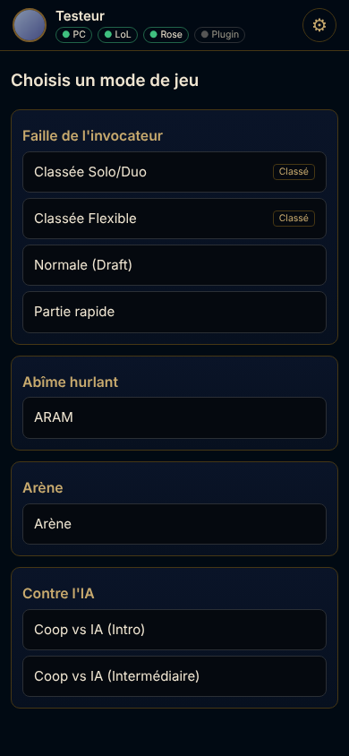
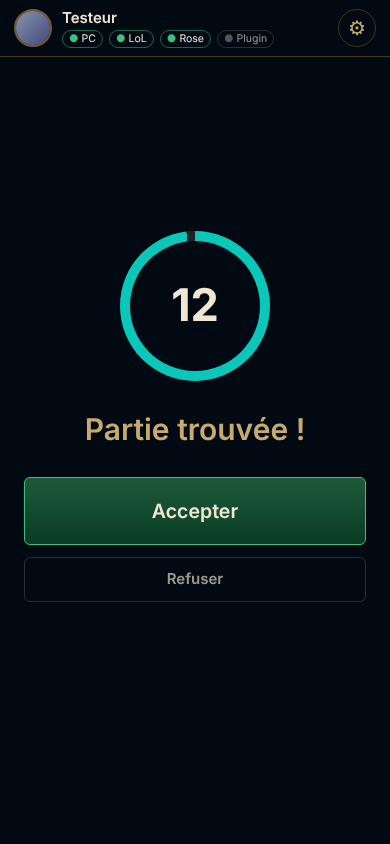
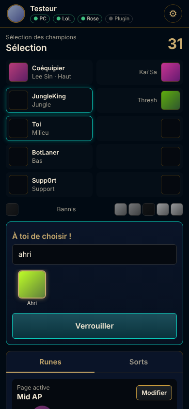
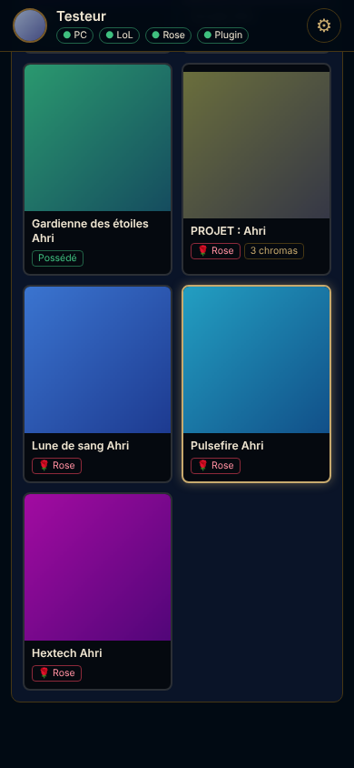
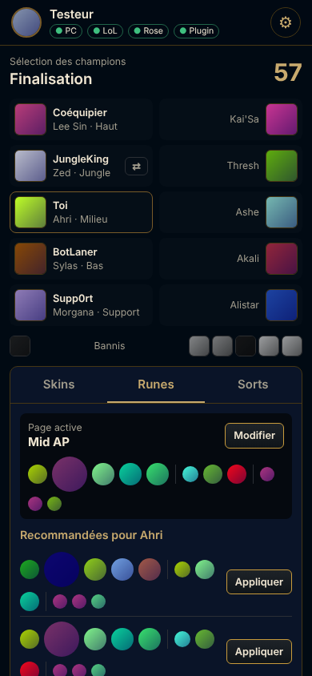

# LolMobil

Pilote le client **League of Legends** depuis ton téléphone : choisis le mode de jeu, lance la file,
**accepte la partie**, bannis et choisis ton champion, puis règle **skin, chromas, runes et sorts**
avant le match. Le projet est **compatible avec [Rose](https://github.com/Alban1911/Rose)** : depuis
le téléphone, tu peux choisir n'importe quel skin, même non possédé, et Rose l'injecte en jeu.

<p align="center">
  
  
  
  
  
</p>

> Captures prises avec le faux client de test (`cmd/mock-lcu`) : c'est pour ça que les images sont des
> dégradés de couleur. Avec le vrai client, ce sont les vraies icônes et illustrations du jeu.

## Fonctionnalités

| | |
|---|---|
| **Salon** | liste des modes (Classé, Normal, Partie rapide, ARAM, Arène, contre l'IA…), création/sortie du salon, rôles principal/secondaire, invitations reçues |
| **File** | lancer/annuler la recherche, temps écoulé et estimé |
| **Partie trouvée** | Accepter / Refuser avec compte à rebours. Sur Android, une **notification avec boutons Accepter/Refuser** arrive même écran éteint. Option « accepter automatiquement » côté PC |
| **Sélection des champions** | équipes, bans, minuteur, recherche de champion, survol, verrouillage, intention en phase de planification, banc ARAM et relance, échanges reçus/proposés. Notification « à toi de jouer » sur Android |
| **Skins** | tous les skins du champion. Ceux que tu possèdes sont sélectionnés par le client. **Avec Rose, ceux que tu ne possèdes pas aussi**, ainsi que les chromas |
| **Builds OP.GG / Blitz** | les builds les plus joués de ton champion pour ton rôle (ou en ARAM/URF), avec taux de victoire. En un clic : **page de runes**, **set d'objets** dans la boutique en jeu (départ, principaux, bottes, ensuite, ordre des compétences) et **sorts** (Saut éclair reste sur ta touche). Option « appliquer automatiquement » au verrouillage du champion, comme les applis Blitz et OP.GG |
| **Runes** | choix de la page active, éditeur complet (arbres, runes, fragments), **pages recommandées** du client en un clic |
| **Sorts** | choix des deux sorts d'invocateur (filtrés selon le mode) |
| **Salon et amis** | inviter des amis en ligne, des joueurs suggérés ou un Riot ID, nommer chef, exclure, donner ou retirer le droit d'inviter |
| **Après la partie** | Rejouer / retour à l'accueil, reconnexion si tu es déconnecté |
| **Accès à distance** | pas besoin d'être sur le même Wi-Fi que le PC : en 4G ou sur n'importe quel réseau, **sans rien configurer**. Les échanges passent par des serveurs MQTT publics gratuits et sont chiffrés de bout en bout. Tu peux aussi utiliser ton propre relais (Cloudflare) |

Sur le même Wi-Fi, le téléphone parle directement au PC. Ailleurs, les messages passent par un serveur
intermédiaire qui ne voit que des données chiffrées.

## Comment ça marche

```
 Téléphone (appli Android ou navigateur)
        │  Wi-Fi : HTTP + WebSocket, protégé par un jeton (appairage par code ou QR)
        ▼
 LolMobil Companion (PC, un seul .exe)
        ├──► Client League (API locale « LCU ») : salon, file, sélection, runes, sorts…
        ├──► Rose (son pont WebSocket local) : skin détecté, chromas
        └──► Plugin LolMobil-Remote (dans le client, via Pengu Loader) : carrousel de skins
```

### Pourquoi un plugin pour Rose ?

Rose ne lit pas le skin choisi dans l'API du client : son plugin `ROSE-SkinMonitor` lit **le nom du
skin affiché dans le carrousel** de la sélection des champions, et le compare en continu. Envoyer un skin
directement à Rose ne marche donc pas : le moniteur le remplace aussitôt par celui que le carrousel
affiche.

LolMobil fait donc comme un humain : le plugin `LolMobil-Remote` (installé automatiquement à côté des
plugins de Rose) **fait défiler le carrousel du client jusqu'au skin choisi sur le téléphone**. Rose voit
ce skin comme si tu l'avais cliqué. Le client sélectionne aussi directement les skins que tu possèdes.
Les chromas sont transmis au pont de Rose avec le même message que sa roue de chromas (`chroma-selection`).

Sans Rose, tout le reste fonctionne, et tu peux choisir les skins que tu possèdes.

## Installation

Télécharge la dernière version dans
[**Releases**](https://github.com/tannenovitch13/lol-mobil/releases). Pour la version en cours de
développement, ouvre l'onglet **Actions**, choisis le dernier build réussi, puis télécharge les artefacts
`companion` et `android`.

### 1. Sur le PC

1. Dézippe `LolMobil-Companion-windows-x64.zip` et lance `LolMobil-Companion.exe`. Comme Conduit pour
   Mimic, il ne s'ouvre pas dans une fenêtre : il se place dans la **zone de notification** (à côté de
   l'horloge). Clic droit sur l'icône : QR code d'appairage, acceptation automatique, **démarrage avec
   Windows**, journal, Quitter.
   - SmartScreen (« Windows a protégé votre ordinateur ») apparaît parce que le programme n'est pas signé :
     clique sur *Informations complémentaires*, puis sur *Exécuter quand même*.
   - **Pare-feu Windows** : autorise l'accès sur les *réseaux privés*. Sinon, le téléphone ne trouvera pas
     le PC.
2. Au premier lancement, la page `http://127.0.0.1:8787/pair` s'ouvre dans le navigateur. Elle affiche
   l'adresse du PC, un **code d'appairage** à 6 chiffres et un QR code. Tu peux la rouvrir depuis l'icône
   (« Connecter un téléphone »).
3. **Avec Rose** : le compagnon copie le plugin `LolMobil-Remote` dans
   `C:\Program Files\Rose\_internal\Pengu Loader\plugins`. Comme ce dossier est protégé, Windows
   affiche une fois une demande d'autorisation (UAC) : accepte-la, puis **redémarre le client LoL**. La
   pastille « Plugin » passe alors au vert dans l'appli.
   - Pengu Loader installé ailleurs : `LolMobil-Companion.exe -pengu-plugins "D:\...\plugins"` (le chemin
     est retenu), ou copie le dossier `LolMobil-Remote` du zip dans ce dossier `plugins`.

Laisse le compagnon tourner pendant que tu joues (ou coche « Démarrer avec Windows »).

### 2. Sur le téléphone

- **Android** : installe `LolMobil.apk` (autorise l'installation depuis cette source si Android le
  demande). Ouvre l'appli : elle cherche les PC sur le Wi-Fi. Touche le tien, puis tape le code
  d'appairage, ou bien **scanne le QR code**. Autorise les notifications pour recevoir « Partie trouvée »
  avec les boutons Accepter/Refuser. Dans les réglages (⚙), le bouton « Autoriser en arrière-plan » évite
  qu'Android coupe la connexion quand l'écran est éteint.
- **iPhone ou sans l'appli** : ouvre l'adresse affichée par le compagnon (par exemple
  `http://192.168.1.20:8787`) dans le navigateur, ou scanne le QR code avec l'appareil photo, puis tape le
  code. Tu peux ajouter la page à l'écran d'accueil. Les notifications en arrière-plan sont réservées à
  l'appli Android.

### 3. Hors de chez toi (pas le même Wi-Fi)

Il n'y a rien à installer ni à configurer. Sur la page d'appairage du compagnon, scanne **une fois** le
second QR code, « Accès à distance », avec l'appli LolMobil. Ensuite, l'appli pilote ton PC depuis la 4G
ou depuis n'importe quel Wi-Fi.

- **Comment ça marche :** le PC et le téléphone se connectent tous les deux, en sortie, à des serveurs
  [MQTT](https://mqtt.org) publics et gratuits (EMQX, HiveMQ, Mosquitto), un protocole de messagerie
  standard. Il n'y a aucun port à ouvrir sur ta box, et ça marche aussi en 4G derrière le réseau de
  l'opérateur. Le PC écoute les trois serveurs à la fois : si l'un tombe, le téléphone passe au suivant.
- **Sécurité :** tout est chiffré de bout en bout (AES-256-GCM) avec la clé contenue dans le QR code. Les
  serveurs ne voient que des données illisibles. Garde ce QR code pour toi ; `-reset-pairing` en crée un
  nouveau.
- **Sans l'appli** (iPhone) : le même QR code ouvre l'interface dans le navigateur, depuis une copie
  publique hébergée sur GitHub.
- **Fiabilité :** ces serveurs publics sont gratuits et sans garantie. Pour une solution qui ne dépend que
  de toi, déploie ton propre relais Cloudflare gratuit (voir [`relay/README.md`](relay/README.md)) et lance
  le compagnon avec `-relay https://…`.
- Désactiver l'accès à distance : `-remote off`.

## Builds OP.GG et Blitz

Dans la sélection des champions, l'onglet **Builds** affiche jusqu'à trois builds populaires pour ton
champion, ton rôle et le mode de jeu (Faille, ARAM, URF). Choisis la source (OP.GG ou Blitz), coche ce
que tu veux appliquer (runes, set d'objets, sorts), puis touche « Appliquer ce build ». Le compagnon :

- réutilise toujours la même page de runes (nommée « OP.GG Ahri Milieu », par exemple) au lieu de
  remplir tes pages ;
- crée ou remplace un **set d'objets** pour ce champion, visible dans la boutique en jeu (onglet des sets
  d'objets) et dans la Collection du client. Comme sur OP.GG, chaque catégorie affiche son taux de
  victoires (« Objets principaux — 56,0 % de victoires ») et le titre rappelle l'ordre des compétences
  (« OP.GG Ahri Milieu · Q > W > E ») ;
- règle les deux sorts, en gardant Saut éclair sur la touche que tu utilises déjà.

L'option **Appliquer automatiquement** fait tout cela dès que ton champion est verrouillé.

Les données viennent des API qu'utilisent les sites et les applis OP.GG et Blitz. Elles ne sont pas
publiques : si un site change son format, la source concernée peut cesser de fonctionner jusqu'à une mise
à jour de LolMobil. L'Arène n'est pas encore prise en charge.

## Options du compagnon

```
-pair                 ouvre la page du QR code
-reset-pairing        nouveau code et nouveau jeton (les téléphones devront se réappairer)
-port 8787            port du serveur (la découverte automatique utilise port+1 en UDP)
-league-path DIR      dossier d'installation de LoL, si la détection automatique échoue
-pengu-plugins DIR    dossier plugins de Pengu Loader où installer LolMobil-Remote
-no-plugin-install    ne pas installer le plugin
-no-rose              ne pas se connecter à Rose
-remote on|off        accès à distance par les serveurs MQTT publics (activé par défaut)
-brokers URL,URL      autres serveurs MQTT (wss://…) ; "default" pour revenir aux serveurs publics
-relay URL            ton relais Cloudflare à la place des serveurs MQTT ("off" pour l'enlever)
-web-url URL          copie de l'interface pour les téléphones sans l'appli
```

La configuration (`config.json`) et le journal (`companion.log`) se trouvent dans `%APPDATA%\LolMobil\`.

## Sécurité

- Le téléphone doit présenter le **jeton** obtenu à l'appairage : le code PIN ou le QR code, visibles
  uniquement sur le PC. Les mauvais codes sont limités à 5 essais par 5 minutes.
- Le compagnon ne relaie qu'une **liste blanche** de chemins de l'API du client (salon, file, sélection,
  runes, données du jeu…). La connexion, la boutique, la fermeture du client et les paramètres restent
  inaccessibles.
- Le plugin dans le client ne se connecte qu'au compagnon, sur `127.0.0.1`. Le compagnon n'accepte le
  plugin que depuis le PC lui-même.

## Avertissement

LolMobil utilise l'API locale du client, comme de nombreux outils tiers. Ce projet n'est ni approuvé ni
soutenu par Riot Games. Les changeurs de skins comme Rose vont à l'encontre des conditions d'utilisation de
Riot : tu les utilises **à tes risques**. LolMobil n'apporte aucun avantage en jeu : il ne fait que ce que
tu pourrais faire en cliquant dans le client.

## Développement

Le compagnon et le faux client sont en Go ≥ 1.24. L'interface mobile utilise Preact et htm, sans étape de
build. L'appli Android est en Kotlin.

```bash
go test ./...                                   # tests unitaires
go run ./cmd/mock-lcu -rose                     # faux client LoL (+ faux Rose) sur :29999
go run ./cmd/lolmobil-companion -lcu-url http://127.0.0.1:29999 -lcu-password test
# puis ouvre http://127.0.0.1:8787 (code affiché dans le terminal)
# raccourcis : http://127.0.0.1:29999/mock/goto?state=champselect|finalization|aram|readycheck|…
# faux carrousel de skins pour tester le plugin : http://127.0.0.1:29999/mock/client

test/e2e/run.sh                                 # test de bout en bout (Playwright), Wi-Fi
test/e2e/run-mqtt.sh                            # accès à distance par MQTT (broker local)
test/e2e/run-remote.sh                          # accès à distance par le relais Cloudflare (wrangler dev)
GOOS=windows GOARCH=amd64 go build ./cmd/lolmobil-companion   # .exe Windows

cd android && ./gradlew assembleRelease         # APK (SDK Android requis)
```

Structure :

| Dossier | Contenu |
|---|---|
| `cmd/lolmobil-companion` | programme PC |
| `internal/lcu` | détection du client (lockfile, processus), requêtes et événements WAMP |
| `internal/rose` | connexion au pont WebSocket de Rose |
| `internal/pengu` | canal avec le plugin et installation dans Pengu Loader / Rose |
| `internal/server` | serveur du téléphone : appairage, relais, découverte UDP, images |
| `internal/relay`, `internal/mqtt`, `relay/` | accès à distance : chiffrement, MQTT, client du relais, relais Cloudflare Worker |
| `web/` | interface mobile (embarquée dans l'exécutable) |
| `pengu-plugin/LolMobil-Remote` | plugin Pengu Loader qui pilote le carrousel de skins |
| `android/` | appli Android : connexion, découverte, QR code, notifications |
| `cmd/mock-lcu`, `test/e2e` | faux client LoL, faux Rose, faux carrousel, tests |

Pour signer l'APK avec ta propre clé, ajoute les secrets `LOLMOBIL_KEYSTORE_BASE64`,
`LOLMOBIL_KEYSTORE_PASSWORD`, `LOLMOBIL_KEY_ALIAS` et `LOLMOBIL_KEY_PASSWORD` au dépôt. Sans ces secrets,
la CI signe avec `android/app/dev-signing.keystore` : tous les builds peuvent ainsi se mettre à jour par
dessus les précédents. Cette clé est publique, donc n'importe qui peut signer un APK avec.

## Crédits

- [Mimic](https://github.com/molenzwiebel/Mimic) de molenzwiebel (MIT) : la première télécommande LoL
  sur téléphone. Mimic n'est plus maintenu depuis 2022 et son relais Rift n'existe plus. LolMobil le
  recode à jour : mêmes fonctions (salon, invitations, file, sélection, runes, accès à distance chiffré,
  compagnon dans la zone de notification) plus Rose et les notifications Android.
- [Rose](https://github.com/Alban1911/Rose) et [Pengu Loader](https://github.com/PenguLoader/PenguLoader).
- [Preact](https://preactjs.com) et [htm](https://github.com/developit/htm),
  [zxing-android-embedded](https://github.com/journeyapps/zxing-android-embedded),
  [OkHttp](https://square.github.io/okhttp/), [gorilla/websocket](https://github.com/gorilla/websocket).

Licence MIT.
